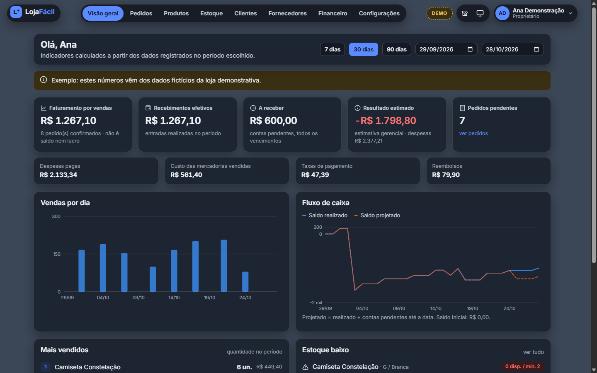
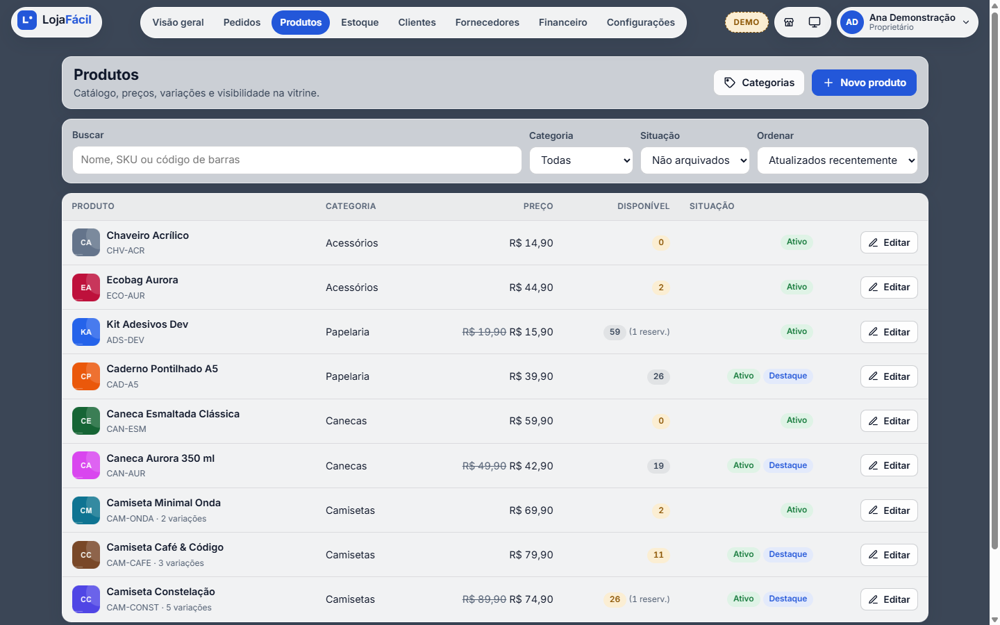
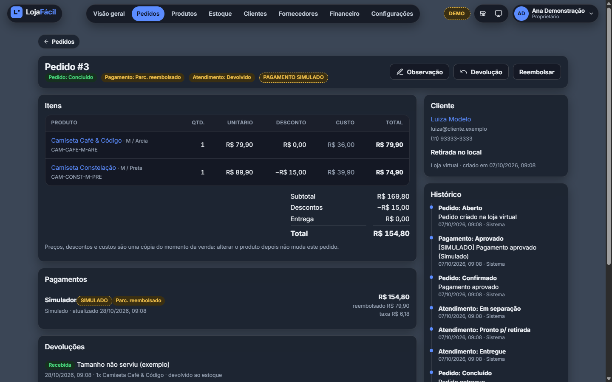
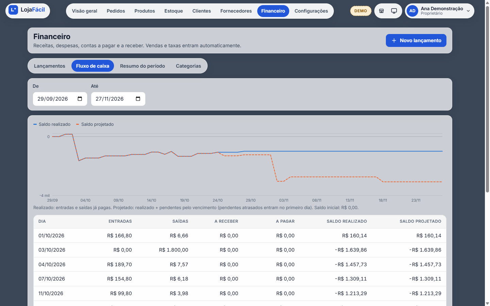
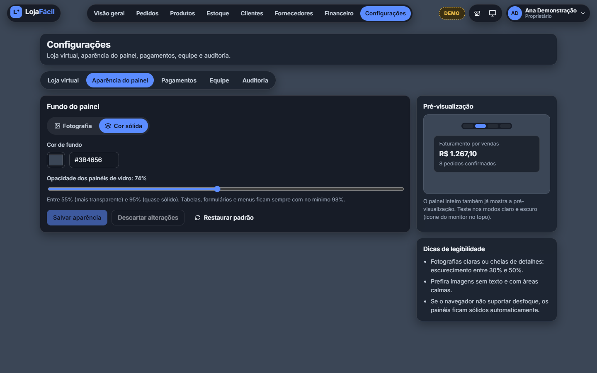
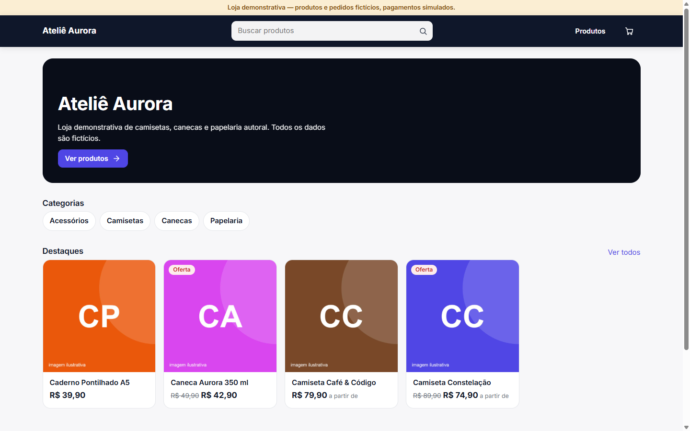
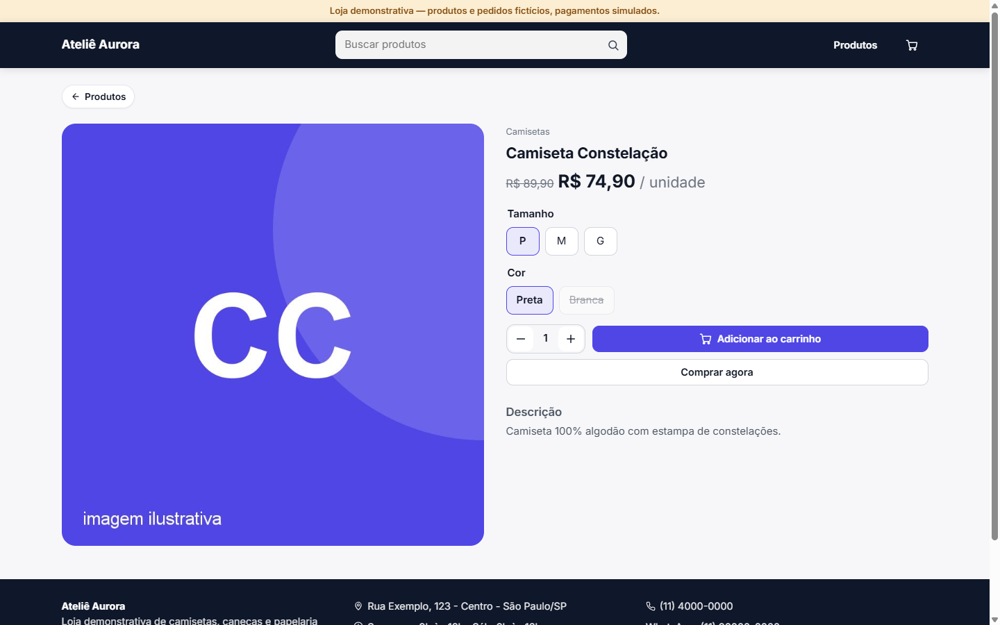
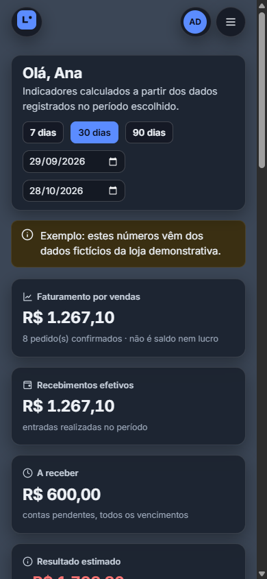
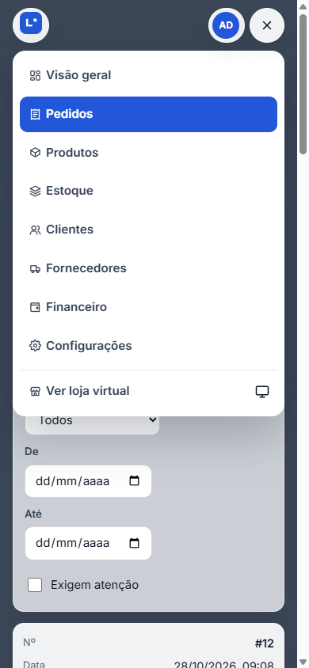

# LojaFácil — Gestão de e-commerce para pequenas lojas

Sistema completo para pequenos lojistas: **painel administrativo** (catálogo, estoque, pedidos,
clientes, fornecedores, financeiro, dashboard, equipe) e **loja virtual pública** (vitrine, carrinho,
checkout como visitante, pagamento online e acompanhamento do pedido). Cada loja tem seus próprios
dados, isolados no backend.

> Projeto de portfólio. **Não emite documentos fiscais** (sem NF-e, NFC-e, NFS-e, DANFE ou tributos).

| Camada | Tecnologia |
|---|---|
| Backend | Java 21, Spring Boot 4.0.6, Spring Security 7, Spring Data JPA / Hibernate 7, Flyway, Maven |
| Banco | PostgreSQL 17 |
| Frontend | Angular 22 (standalone, signals, zoneless), TypeScript, SCSS |
| Pagamentos | Mercado Pago Checkout Pro (teste) + simulador local |
| Documentação da API | OpenAPI / Swagger UI (springdoc) |
| Infra local | Docker Compose (PostgreSQL, Mailpit, backend, frontend/Nginx) |

## Telas

Capturas do ambiente demonstrativo (todos os dados são fictícios e os pagamentos são simulados).



| Produtos (modo claro) | Detalhe do pedido (modo escuro) |
|---|---|
|  |  |
| **Fluxo de caixa realizado e projetado** | **Aparência do painel (fundo e vidro por loja)** |
|  |  |
| **Loja virtual** | **Página de produto com variações** |
|  |  |

<p>
  
  &nbsp;
  
</p>

---

## 1. Como executar

### Opção A — tudo com Docker (mais simples)

```bash
cp .env.example .env
```

```bash
docker compose up --build
```

| Serviço | Endereço |
|---|---|
| Aplicação (painel + loja) | http://localhost:4200 |
| Loja demonstrativa | http://localhost:4200/loja/demo |
| Swagger (documentação da API) | http://localhost:4200/swagger-ui.html |
| Mailpit (e-mails de teste: senha, convites, pedidos) | http://localhost:8025 |

Com o perfil `demo` (padrão do `.env.example`), a loja **Ateliê Aurora** é criada com dados fictícios:

| Perfil | E-mail | Senha |
|---|---|---|
| Proprietário | `demo@lojafacil.dev` | `Demo@1234` |
| Gerente | `gerente@lojafacil.dev` | `Demo@1234` |
| Operador | `operador@lojafacil.dev` | `Demo@1234` |

Essas credenciais existem **somente** no ambiente demonstrativo. Para uso real, use
`SPRING_PROFILES_ACTIVE=prod` e `APP_DEMO_MODE=false` (nenhum dado fictício é criado).

### Opção B — desenvolvimento (hot reload)

Pré-requisitos: JDK 21, Maven 3.9+, Node 22+, Docker (para o PostgreSQL).

```bash
docker compose up -d postgres mailpit
```

```bash
cd backend && mvn spring-boot:run -Dspring-boot.run.profiles=demo
```

```bash
cd frontend && npm install && npm start
```

O Angular roda em http://localhost:4200 e repassa `/api` para o backend (`proxy.conf.json`),
então frontend e API ficam na mesma origem — sem CORS no navegador.

### Opção C — sem Docker (PostgreSQL embutido)

Se o Docker não estiver disponível, o backend pode rodar com um PostgreSQL 17 embutido
(binários oficiais distribuídos pelo Maven Central via `io.zonky.test:embedded-postgres`, só em
desenvolvimento). Os dados ficam em `backend/data/dev-postgres`.

```bash
cd backend && mvn spring-boot:test-run -Dspring-boot.run.main-class=com.lojafacil.LocalDevApplication -Dspring-boot.run.profiles=demo
```

```bash
cd frontend && npm install && npm start
```

### Testes

```bash
cd backend && mvn test
```

Os testes de integração usam um PostgreSQL real: via **Testcontainers** quando o Docker está disponível
e, sem Docker, o PostgreSQL embutido automaticamente. Para forçar o embutido:

```bash
cd backend && LF_TEST_DB=embedded mvn test
```

---

## 2. Arquitetura

**Monólito modular**: uma única aplicação Spring Boot, organizada em módulos de negócio com
fronteiras claras. É simples de executar e implantar, mas mantém o código separado por assunto.

```
backend/src/main/java/com/lojafacil
├── auth/        cadastro, login, recuperação de senha, convites, equipe
├── store/       lojas, personalização (cores com contraste validado, logo, banner)
├── catalog/     categorias, produtos, variantes, fotos, vitrine pública
├── inventory/   saldos, movimentações, reservas (travamento de linha)
├── customers/   clientes e fornecedores
├── orders/      pedidos, máquina de estados, preços, devoluções, acompanhamento
├── payments/    PaymentProvider, simulador, Mercado Pago, webhooks, reembolsos, jobs
├── finance/     lançamentos, parcelas, baixas, estornos, fluxo de caixa, resumo
├── dashboard/   indicadores do período
├── demo/        dados demonstrativos (perfil "demo")
└── shared/      segurança, erros, auditoria, dinheiro, arquivos, criptografia
```

Em cada módulo:

- **Controller** — recebe HTTP, valida a entrada (Bean Validation), chama o serviço. Não tem regra de negócio.
- **Service** — regras de negócio e transações.
- **Repository** — acesso ao banco (Spring Data JPA, consultas parametrizadas).
- **DTOs (records)** — o que entra e sai da API. **Entidades JPA nunca são expostas.**

```
frontend/src/app
├── core/        modelos, chamadas HTTP, sessão, tema, formatação (R$, datas)
├── shared/      ícones, modal acessível, gráficos SVG, paginação, skeletons
├── public/      apresentação, login, cadastro em 2 etapas, recuperação, convite
├── admin/       painel (todas as telas carregadas sob demanda)
└── storefront/  vitrine com o tema do lojista, carrinho, checkout, acompanhamento
```

Documentos complementares:

- [Modelo de dados (diagrama)](docs/modelo-de-dados.md)
- [Fluxo de compra e pagamento](docs/fluxo-de-compra.md)
- [Configurar pagamentos de teste (Mercado Pago)](docs/pagamentos-teste.md)
- [Decisões técnicas](docs/decisoes-tecnicas.md)

---

## 3. Funcionalidades

**Acesso e equipe** — cadastro em duas etapas (responsável → loja), login com mostrar/ocultar senha,
recuperação por link de uso único (30 min), logout, sessão expira após 30 min sem uso. Perfis
Proprietário, Gerente e Operador; convites por e-mail; desativar um colaborador corta o acesso
na próxima requisição.

**Catálogo** — produtos simples ou com até duas variações (ex.: tamanho e cor), SKU e estoque por
variante, preço de custo/venda/promocional, fotos (validadas e otimizadas), categorias, busca,
filtros, ordenação e paginação no servidor. Produtos com histórico são **arquivados**, nunca apagados.

**Estoque** — saldo físico, reservado e disponível; entrada, saída e ajuste com justificativa,
usuário e data; histórico completo; alertas de estoque mínimo; reserva com prazo configurável.

**Pedidos** — três estados independentes (pedido, pagamento, atendimento) com transições validadas;
pedido manual com as mesmas regras da vitrine; cancelamento (com reembolso e retorno ao estoque se
pago e ainda não enviado); devoluções que só repõem estoque após recebimento e conferência; histórico.

**Loja virtual** — URL própria (`/loja/{identificador}`), banner, categorias, destaques, busca e
filtros, página de produto com seleção de variantes, carrinho, checkout como visitante,
confirmação e acompanhamento por link com token secreto.

**Pagamentos** — Mercado Pago Checkout Pro (teste) ou simulador local claramente identificado;
webhooks com assinatura validada; processamento idempotente; reembolso total/parcial.

**Financeiro** — receitas, despesas, categorias, contas a pagar/receber, parcelamento, baixas,
estornos rastreáveis, fluxo de caixa realizado e previsto, filtros por período/categoria/situação.

**Dashboard** — faturamento, recebimentos, a receber, despesas, resultado estimado, pedidos
pendentes, estoque baixo, mais vendidos, gráficos de vendas e fluxo de caixa — com definição de cada
indicador na interface.

**Aparência do painel** — o painel usa painéis de vidro fosco sobre um fundo escolhido pela loja
(Configurações → Aparência do painel): fotografia enviada pelo lojista ou cor sólida, ponto de foco da
foto, escurecimento uniforme (0–70%) e opacidade dos painéis (55–95%). As alterações aparecem como
pré-visualização no painel inteiro e só valem ao salvar; "Restaurar padrão" volta à cor sólida.
A fotografia é validada (JPG/PNG, até 10 MB, mínimo 640×360) e regravada pelo servidor como JPEG
progressivo de até 2400 px. Tabelas, formulários e menus usam superfícies com no mínimo 93% de
opacidade; sem suporte a desfoque (ou com "reduzir transparência" ativo), os painéis ficam sólidos;
no celular o desfoque é reduzido. Além disso, o painel mede a luminosidade da fotografia e, se
necessário, **eleva a opacidade automaticamente** para manter contraste WCAG AA (4,5:1) no tema em uso
(ex.: foto clara no modo escuro) — a tela de aparência avisa quando isso acontece. A aparência é da loja (vale para toda a equipe); o modo
claro/escuro continua sendo preferência pessoal de cada usuário.

### Glossário dos indicadores

| Indicador | Definição |
|---|---|
| Faturamento por vendas | Soma dos pedidos confirmados (pagos) no período, pela data de confirmação. **Não é saldo nem lucro.** |
| Recebimentos efetivos | Entradas realizadas (pagas) no período, descontados estornos de receitas. |
| A receber | Contas a receber pendentes (qualquer vencimento); destaque para as vencidas. |
| Despesas pagas | Despesas manuais baixadas no período, descontados estornos. |
| Despesas operacionais | Despesas manuais por vencimento no período (competência). |
| CMV | Custo das mercadorias vendidas: custo gravado nos itens dos pedidos confirmados. |
| Resultado gerencial estimado | Faturamento − CMV − taxas − reembolsos − despesas operacionais. Estimativa, sem valor contábil. |

---

## 4. Regras de negócio que valem destacar

- **Dinheiro**: `BigDecimal` no Java e `NUMERIC(14,2)` no banco. Arredondamento `HALF_UP` para centavos.
  Parcelas: o total é dividido em centavos inteiros e os centavos restantes vão para as primeiras
  parcelas (R$ 100 em 3x = 33,34 + 33,33 + 33,33). Ver `shared/money/Money.java`.
- **Preços sempre no servidor**: o navegador envia apenas "variante + quantidade". Preço, desconto,
  entrega e total são recalculados pelo backend.
- **Itens do pedido são uma "fotografia"**: nome, SKU, variante, preço, desconto e custo do momento da venda.
- **Estoque nunca negativo**: travamento de linha (`SELECT ... FOR UPDATE`) + `CHECK` no banco.
- **Pagamento confirmado só pelo servidor**: o redirecionamento do navegador nunca marca um pedido como pago.
- **Sem duplicidade**: baixa de estoque controlada por flag no pedido; lançamentos financeiros com
  índice único por origem (`payment:42`, `refund:7`...); webhooks deduplicados por chave única.
- **Pagamento depois da expiração**: se ainda houver estoque, o pedido é reativado com aviso;
  se não houver, o pagamento é registrado e o pedido fica marcado para reembolso — sem estoque negativo.
- **Correções financeiras por estorno**: lançamentos realizados não são editados nem apagados.

---

## 5. Segurança — o que foi implementado

O sistema **não é "impenetrável"**; estas são as medidas implementadas e suas limitações.

| Medida | Como |
|---|---|
| Senhas | BCrypt (via `DelegatingPasswordEncoder`, permite migrar de algoritmo). Política mínima: 8+ caracteres com letras e números. |
| Sessão | Cookie `JSESSIONID` HttpOnly, SameSite=Lax, `Secure` em produção (`APP_COOKIE_SECURE=true`). Id de sessão trocado no login (anti fixação). Expira em 30 min. |
| CSRF | Token em cookie `XSRF-TOKEN` + cabeçalho `X-XSRF-TOKEN` (suporte nativo do Angular). Webhooks isentos, pois têm assinatura própria. |
| Isolamento entre lojas | A loja vem **sempre da sessão**; todas as consultas filtram por `store_id`; registros de outra loja respondem 404. Testado em `SecurityAndTenantIT`. |
| Permissões | `@PreAuthorize` por perfil em cada endpoint; perfil revalidado a cada requisição. |
| Limite de tentativas | 5 falhas por e-mail e por IP em 15 min no login; limite também na recuperação de senha. |
| Tokens | 256 bits aleatórios; no banco só o hash SHA-256; validade e uso único (senha e convite). |
| Credenciais de pagamento | Cifradas com AES-256-GCM (`APP_ENCRYPTION_KEY`), mascaradas na interface, nunca registradas em log. |
| Webhooks | Assinatura HMAC-SHA256 validada em tempo constante; situação real sempre consultada no provedor. |
| Uploads | Limite de 3 MB, formato pelos "magic bytes", imagem decodificada e regravada (remove metadados), nome UUID gerado no servidor, proteção contra path traversal. |
| Erros | Padronizados (Problem Details, RFC 9457), sem stack trace ou SQL para o cliente. |
| CORS | Restrito às origens configuradas (em produção, frontend e API na mesma origem via Nginx). |
| Auditoria | Estoque, pedidos, financeiro, equipe e configurações sensíveis registram usuário, ação e data. |
| Demonstração | `APP_DEMO_MODE=true` bloqueia credenciais reais; `APP_ALLOW_LIVE_PAYMENTS=false` rejeita transações `live_mode`. |

### Limitações conhecidas

- O limite de tentativas de login fica em memória (por instância; zera ao reiniciar).
- Sessões ficam na memória do servidor: reiniciar desloga todos; para várias instâncias, usar Spring Session JDBC.
- Arquivos enviados ficam em disco local (volume Docker); para produção em nuvem, usar armazenamento de objetos.
- Trocar a senha não encerra outras sessões já abertas do mesmo usuário (expiram em até 30 min).
- Sem Content-Security-Policy restritiva (o tema é aplicado por um script inline mínimo no `index.html`).
- Webhooks do Mercado Pago exigem URL HTTPS pública; localmente, a confirmação ocorre pela consulta
  ao voltar do checkout e pela conciliação periódica (a cada 5 min).
- Sem integração com transportadoras (apenas retirada e entrega local com taxa fixa) e sem cupons de desconto.
- Sem emissão fiscal, por decisão de escopo.

---

## 6. Desempenho

- Paginação e filtros no servidor; limite máximo de 100 itens por página.
- Índices nas colunas de busca e filtro (loja + data, loja + status, vencimento, etc.).
- Prevenção de N+1: `@EntityGraph`, `default_batch_fetch_size` e busca de nomes de usuários em lote.
- Angular: todas as telas com lazy loading; pacote inicial ≈ 90 kB transferidos.
- Busca com debounce (300 ms) e cancelamento de requisições ultrapassadas (`switchMap`).
- Imagens redimensionadas no upload, servidas com cache longo e `loading="lazy"`.
- Webhooks respondem rápido e processam em segundo plano (`@Async`).
- Sem Redis ou mensageria: para o volume de uma pequena loja, PostgreSQL + jobs agendados bastam.

---

## 7. Testes automatizados (44 testes)

| Arquivo | O que cobre |
|---|---|
| `MoneyTest` | Arredondamento, multiplicação exata, parcelas que somam o total |
| `OrderStateMachineTest` | Transições válidas e inválidas de pedido, pagamento e atendimento |
| `MercadoPagoSignatureTest` | Validação do HMAC dos webhooks (aceita correto, recusa adulterado) |
| `ColorContrastTest` | Contraste WCAG das cores da vitrine |
| `SecurityAndTenantIT` | Isolamento entre lojas, permissões por perfil, 401/403, colaborador desativado |
| `PurchaseFlowIT` | Compra completa, **compras simultâneas da última unidade**, webhooks duplicados, notificação fora de ordem, valor divergente, expiração da reserva, pagamento tardio com e sem estoque, cancelamento com reembolso, reembolso parcial, pagamento recusado |
| `FinanceAndInventoryIT` | Parcelamento e baixas, estorno, estoque nunca negativo, isolamento no estoque |
| `AppearanceIT` | Fotografia de fundo otimizada (≤ 2400 px, JPEG), só aplicada ao salvar, limites de legibilidade, foto de outra loja recusada, operador sem permissão |

Os testes `*IT` usam PostgreSQL real (Testcontainers ou embutido), porque travas de linha, `CHECK`s e índices
únicos são exatamente o que está sendo verificado.
