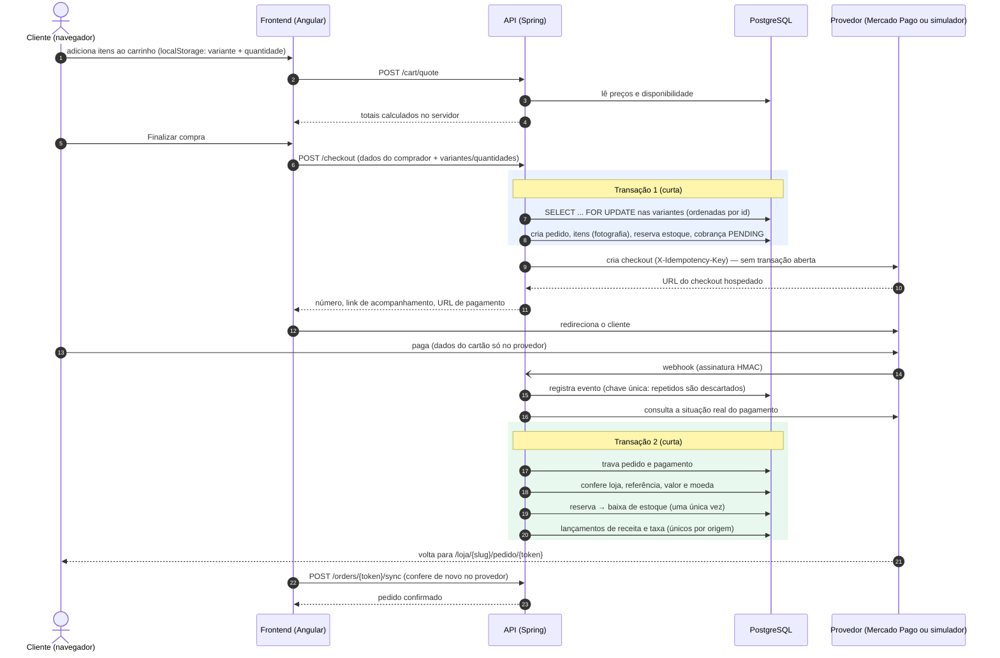

# Fluxo de compra

## Caminhos alternativos

| Situação | Comportamento |
|---|---|
| Duas pessoas compram a última unidade ao mesmo tempo | A segunda transação espera a trava da primeira e então vê o saldo zerado: recebe "esgotado". |
| Cliente não paga no prazo | Job a cada minuto: consulta o provedor (caso o webhook tenha se perdido); sem pagamento, libera a reserva, pagamento = Expirado, pedido = Cancelado. |
| Pagamento aprovado após a expiração | Se ainda houver estoque: baixa e reativa o pedido com aviso. Se não houver: registra o pagamento, mantém o pedido cancelado e o marca "exige atenção" para reembolso. Nunca gera saldo negativo. |
| Webhook repetido | O evento já existe na tabela `webhook_events` → descartado. Mesmo que fosse processado, o estado final seria o mesmo. |
| Notificação antiga chega depois da aprovação | Ignorada: um pagamento aprovado nunca volta para pendente/recusado. |
| Valor ou moeda divergentes | Pedido não é confirmado; fica marcado "exige atenção". |
| Pagamento recusado | Pedido continua aberto, estoque reservado; o cliente pode tentar de novo pelo link. |
| Falha ao criar o checkout | O pedido é mantido; o cliente usa "Pagar agora" na página do pedido (mesma chave de idempotência). |
| Cancelamento de pedido pago (antes do envio) | Reembolso no provedor (fora de transação) → itens voltam ao estoque → pedido cancelado. |
| Devolução | Registrada; o estoque só é reposto quando o recebimento é confirmado e o item está em condições de revenda. |
