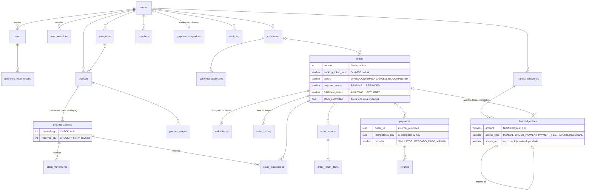

# Modelo de dados

Esquema criado pela migração Flyway `backend/src/main/resources/db/migration/V1__schema_inicial.sql`.
Todas as tabelas de negócio têm `store_id`: é a base do isolamento entre lojas.

Tabelas de apoio não mostradas: `webhook_events` (deduplicação de notificações, chave única
`provider + event_key`) e `simulator_charges` (o "lado do provedor" do simulador local).

## Decisões de modelagem

- **Toda unidade vendável é uma variante.** Produto simples = uma variante "padrão". Assim estoque,
  reservas e itens de pedido apontam sempre para o mesmo tipo de registro.
- **Saldo físico e reservado na variante**, com `CHECK` no banco. Disponível = físico − reservado.
- **Valores sempre positivos** em `financial_entries`; o tipo (`INCOME`/`EXPENSE`) define o sinal.
  Um estorno é um novo lançamento do tipo oposto apontando para o original (`reversal_of_id`).
- **Chaves únicas parciais** (`WHERE source_ref IS NOT NULL`, `WHERE provider_payment_id IS NOT NULL`)
  garantem idempotência sem impedir lançamentos manuais.
- **Tokens guardados como hash** (`tracking_token_hash`, `token_hash`): se o banco vazar, links continuam inutilizáveis.
